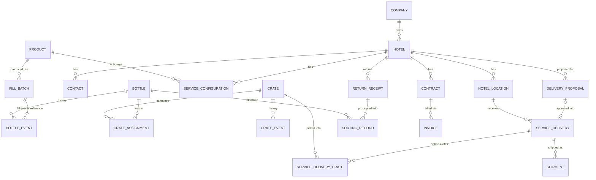

# 003 — Domain Model

This document defines the shared vocabulary of AYVO OS and the proposed relationships between domain concepts. No database models are implemented in the foundation phase; this is the target model to refine before implementation.

Status: Draft — foundation phase (2026-10-10)

## Confirmed requirements

- Every physical bottle has one permanent internal identity, one permanent unique QR identity and a complete auditable lifecycle history.
- The bottle internal ID and the public QR identity are **separate**; the public QR identity is opaque and practically unguessable, and its public URL stays stable for the bottle's physical lifetime _(confirmed by owner 2026-10-10)_.
- Bottles have a **size** attribute _(confirmed by owner 2026-10-10)_; the set of sizes is still open.
- Crates have permanent IDs and QR codes. Standard outbound capacity: 20 bottles _(confirmed by owner 2026-10-10)_.
- A **READY** outbound crate contains exactly 20 bottles of the same product and size _(confirmed by owner 2026-10-10)_.
- Return crates may be partial, mixed, or initially contain unknown bottle identities _(confirmed by owner 2026-10-10)_.
- Crate membership is temporary and historical.
- A bottle can never belong to two active crates simultaneously.
- RETIRED is operationally terminal but may be reversed by an authorized, audited correction; DISPOSED/DESTROYED is irreversible _(confirmed by owner 2026-10-10)_. See [ADR 0011](adr/0011-bottle-terminal-states-and-reuse-cycles.md).
- A completed reuse cycle = the bottle was delivered to a hotel and subsequently returned and individually identified by AYVO _(confirmed by owner 2026-10-10)_.
- Hotels have contracts priced per contracted room per month; billing and logistics are separate domains _(confirmed by owner 2026-10-10)_.
- Service deliveries are recurring; automatic planning creates proposals requiring AYVO approval.

## Glossary

| Term                    | Meaning                                                                                                                  |
| ----------------------- | ------------------------------------------------------------------------------------------------------------------------ |
| Product                 | A cosmetic product (e.g. Hand Soap, Hair & Body Wash) filled into bottles                                                |
| Bottle                  | A physical reusable bottle with permanent internal identity and a size attribute                                         |
| Bottle size             | Physical size of a bottle; part of the READY-crate rule (same product and size). Size values are open                    |
| QR identity             | The permanent unique code printed on a bottle or crate; for bottles, opaque and separate from the internal ID            |
| READY crate             | Outbound crate holding exactly 20 bottles of the same product and size, usable as one logistics unit                     |
| Reuse cycle             | Completed when a bottle delivered to a hotel is returned and individually identified by AYVO                             |
| Crate                   | A reusable transport crate with permanent identity; primary logistics unit                                               |
| CrateAssignment         | A time-bounded record that a bottle was in a crate (assigned_at / released_at)                                           |
| FillBatch               | A production batch of a product used to fill bottles                                                                     |
| Company                 | Legal/billing entity of a customer                                                                                       |
| Hotel                   | A customer hotel (belongs to a company)                                                                                  |
| HotelLocation           | A physical/shipping location of a hotel                                                                                  |
| Contact                 | A person at a hotel/company                                                                                              |
| Contract                | Commercial agreement: contracted rooms, price per room per month, billing cycle, payment terms                           |
| ServiceConfiguration    | Per-hotel, per-product operational settings: active products, target/minimum stock, service frequency, preferred carrier |
| DeliveryProposal        | System-generated proposed delivery requiring AYVO approval                                                               |
| ServiceDelivery         | An approved delivery to a hotel location, picked as crates                                                               |
| Shipment                | Carrier-level shipment of a service delivery (tracking, label, status)                                                   |
| ReturnReceipt           | Goods-in record of crates returned from a hotel, with physical quantity                                                  |
| SortingRecord           | Processing record where an individual returned bottle is identified and routed                                           |
| BillingPeriod / Invoice | Contract-based billing artefacts                                                                                         |
| BottlePassport          | Public, whitelisted view of a bottle's verified data                                                                     |

## Proposed design (requires confirmation)

### Relationships

### Key modelling decisions

| Decision                                                                         | Rationale                                                                    | ADR                                                 |
| -------------------------------------------------------------------------------- | ---------------------------------------------------------------------------- | --------------------------------------------------- |
| Bottle current state + append-only `bottle_events`                               | Fast queries, full history                                                   | [0006](adr/0006-auditable-lifecycle-history.md)     |
| Crate membership as `crate_assignments` rows with `released_at`                  | Membership is temporary and historical                                       | [0004](adr/0004-crate-as-primary-logistics-unit.md) |
| Partial unique index on `crate_assignments(bottle_id) WHERE released_at IS NULL` | DB-level guarantee: never two active crates                                  | [0004](adr/0004-crate-as-primary-logistics-unit.md) |
| Bottle internal ID separate from public QR identity (confirmed)                  | Permanent identity; opaque, unguessable public handle with stable URL        | [0005](adr/0005-permanent-bottle-identity.md)       |
| Hotel location history captured on events (delivery → location)                  | Reconstruct where a bottle has been (hotel, location, city, region, country) | [0006](adr/0006-auditable-lifecycle-history.md)     |
| Contract and billing in their own module                                         | Billing is not driven by logistics                                           | [0007](adr/0007-separate-billing-from-logistics.md) |
| Proposal and delivery are distinct entities                                      | Proposals need AYVO approval                                                 | [008](008-service-deliveries.md)                    |

### Location reconstruction

A bottle's whereabouts are reconstructed from its events plus crate assignments plus the crate's delivery membership. Address data on events should be a snapshot (or a reference to an immutable address version) so later edits of a hotel address do not rewrite history.

### Module ownership

See [002 — System Principles](002-system-principles.md#module-boundaries).

## Open questions

- QR payload, URL and domain format (opacity, unguessability and URL stability are confirmed; the concrete format is not).
- Which bottle sizes exist?
- Is a bottle permanently bound to one product, or can it be refilled with a different product?
- Do crates have types other than the standard outbound crate (e.g. dedicated return crates)?
- Is a hotel always under exactly one company? Can a company have many hotels with one combined invoice?
- Are fill batches tracked with lot numbers/expiry dates?
