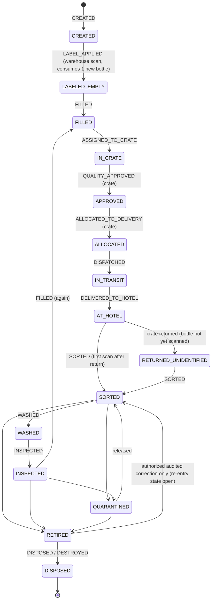

# 004 — Bottle Lifecycle

This document describes the lifecycle of a physical AYVO bottle, its identity rules and how its history is recorded so that AYVO can always reconstruct where a bottle has been and when.

Status: Draft — foundation phase (2026-10-10)

## Confirmed requirements

- Every physical bottle has **one permanent internal digital identity** and **one permanent unique QR identity**.
- The internal ID and the public QR identity are **separate**. The public QR identity is **opaque and practically unguessable**, and public QR URLs remain **stable for the physical lifetime** of the bottle _(confirmed by owner 2026-10-10)_.
- Every bottle has a **complete auditable lifecycle history**.
- A bottle passes through many fill batches, crates, deliveries, hotels, hotel locations, cities, regions, countries, returns, wash cycles and inspections.
- The system must be able to reconstruct exactly where a bottle has been and when.
- Historical events must **never be silently rewritten**.
- A bottle must **never simultaneously belong to two active crates**.
- **RETIRED** is operationally terminal, but may be reversed by an **authorized, audited correction** _(confirmed by owner 2026-10-10)_.
- **DISPOSED/DESTROYED** is **irreversible** _(confirmed by owner 2026-10-10)_.
- A **completed reuse cycle** means the bottle was delivered to a hotel and was subsequently returned **and individually identified** by AYVO _(confirmed by owner 2026-10-10)_.
- See [ADR 0011](adr/0011-bottle-terminal-states-and-reuse-cycles.md).
- Returned bottles are identified individually during sorting/processing and can be routed to washing, inspection, quarantine or retirement.

## Example lifecycle (from the brief)

The brief gives this **example** sequence, not a complete formal state machine:

```
CREATED → FILLED → ASSIGNED_TO_CRATE → QUALITY_APPROVED → ALLOCATED_TO_DELIVERY
→ DISPATCHED → DELIVERED_TO_HOTEL → AT_HOTEL → RETURNED → SORTED → WASHED
→ INSPECTED → FILLED_AGAIN → ... → RETIRED
```

## Proposed design (requires confirmation)

### Events vs. status

Proposal: separate **events** (things that happened, append-only) from **status** (current state, derived and stored for performance).

Proposed event types: `CREATED`, `FILLED`, `ASSIGNED_TO_CRATE`, `REMOVED_FROM_CRATE`, `QUALITY_APPROVED`, `ALLOCATED_TO_DELIVERY`, `DISPATCHED`, `DELIVERED_TO_HOTEL`, `RETURNED`, `SORTED`, `WASHED`, `INSPECTED`, `QUARANTINED`, `RELEASED_FROM_QUARANTINE`, `RETIRED`, `DISPOSED`, `CORRECTION`.

Note: crate-level operations (allocate, dispatch, deliver) apply to all bottles known to be in the crate without rescanning them; see [005](005-crate-lifecycle.md). Whether these produce one event per bottle or one crate event referenced by bottles is an implementation choice (proposal: crate event + per-bottle event rows written in the same transaction, for simple per-bottle history queries).

### Proposed status set



**Implemented in Milestone 1 (DEV)** ([016](016-bottles-and-labels.md)): event `CREATED` and status `CREATED`. The initial status is named `CREATED` per the owner's milestone brief (an earlier draft of this diagram called it `EMPTY_NEW`).

**Implemented in Milestone 2A (DEV)** ([018](018-inbound-stock-and-label-activation.md), owner 2026-10-11): `CREATED → LABELED_EMPTY` by the event `LABEL_APPLIED` — the printed QR label is physically on the bottle body ("Etiketa nalepena – prázdná lahev"); the transition consumes exactly one new bottle from a selected stock lot and opens the bottle's `LABEL` component attachment. A `CREATED` bottle is an identity (and possibly a printed label), not yet a physical bottle. All later states are still a proposal.

RETIRED (operationally terminal, reversible only by authorized audited correction) and DISPOSED/DESTROYED (irreversible) are **confirmed**; all other states and transitions above are a **proposal**, including the re-entry state after reversing a retirement. The transition table will be implemented as an explicit allow-list in the assets module and covered by tests.

### Invariants

| Invariant                          | Enforcement (proposal)                                                                                         |
| ---------------------------------- | -------------------------------------------------------------------------------------------------------------- |
| Permanent, unique internal ID      | UUID primary key, never reused                                                                                 |
| Permanent, unique QR identity      | Unique constraint; no update path for the QR value                                                             |
| Never in two active crates         | Partial unique index on `crate_assignments(bottle_id) WHERE released_at IS NULL`                               |
| Retired is operationally terminal  | Transition allow-list: only an authorized `CORRECTION` (with actor, reason, authorization) can leave `RETIRED` |
| Disposed/destroyed is irreversible | Transition allow-list + DB check/trigger rejecting any event (including corrections) after `DISPOSED`          |
| History immutable                  | `bottle_events` is append-only (no UPDATE/DELETE grants for the app DB role)                                   |
| State + event consistency          | Status update and event insert in one transaction                                                              |

### Corrections

A wrong scan is fixed by appending a `CORRECTION` event that references the erroneous event and states the reason and actor. The original event remains visible.

Reversing a retirement _(confirmed by owner 2026-10-10)_: allowed only as an authorized, audited correction event — the original `RETIRED` event is never altered. A `DISPOSED` bottle can never be corrected back into circulation.

### Event record (proposal)

| Field                                                                      | Notes                                                |
| -------------------------------------------------------------------------- | ---------------------------------------------------- |
| id                                                                         | UUID                                                 |
| bottle_id                                                                  | FK                                                   |
| type                                                                       | event type                                           |
| occurred_at / recorded_at                                                  | physical time vs. system time                        |
| actor_id                                                                   | user or system                                       |
| crate_id, fill_batch_id, delivery_id, return_receipt_id, hotel_location_id | optional context references                          |
| location snapshot                                                          | hotel / city / region / country at the time          |
| corrects_event_id                                                          | for corrections                                      |
| payload                                                                    | small JSON for event-specific data, validated by Zod |

### Reuse cycle count

Definition _(confirmed by owner 2026-10-10)_: a reuse cycle is completed when a bottle that was delivered to a hotel (`DELIVERED_TO_HOTEL`) is subsequently returned **and individually identified** by AYVO. Proposal: count the cycle at the first sorting identification event (`SORTED`) following a `DELIVERED_TO_HOTEL`; a returned crate whose bottles have not yet been identified does not complete any cycle. Used by the passport ([011](011-sustainability.md)); derived from events, optionally cached as a counter on the bottle.

## Open questions

- ~~QR payload/URL/domain format~~ (resolved: [ADR 0014](adr/0014-public-qr-identity-and-url.md)); engraving vs. printed labels, and what happens if a QR label becomes unreadable or damaged (re-label while keeping identity?).
- Retirement criteria (max reuse cycles, damage, inspection failure) and who may retire a bottle.
- Who is authorized to reverse a retirement, and which state the bottle re-enters (e.g. SORTED or QUARANTINED).
- Are DISPOSED and DESTROYED one state or two?
- Quarantine criteria and release rules.
- Can a bottle be refilled with a different product than before?
- Which bottle sizes exist (size is a confirmed attribute; values are open)?
- How are lost bottles (never returned) handled — status, and after how long?
- Is a crate-level `QUALITY_APPROVED` sufficient, or is per-bottle approval needed?
