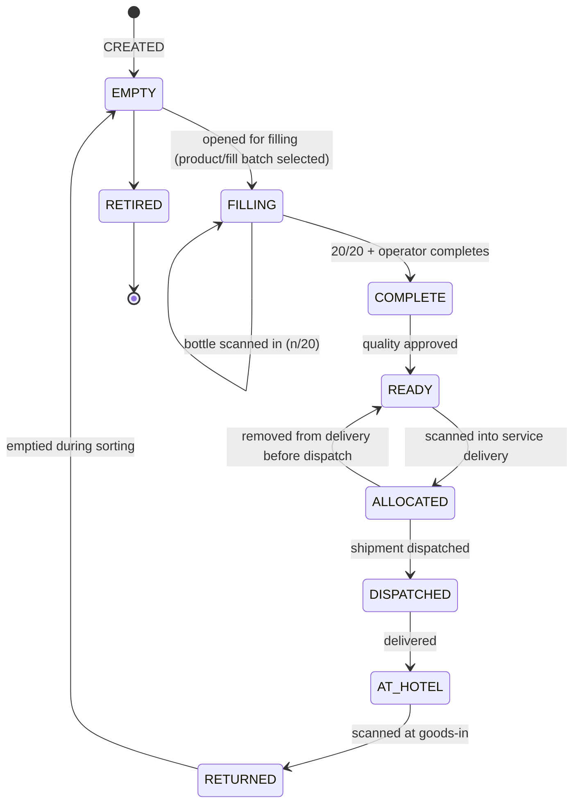

# 005 — Crate Lifecycle

This document describes reusable transport crates, crate membership and why the crate is the primary physical logistics unit.

Status: Draft — foundation phase (2026-10-10)

## Confirmed requirements

- Crates are reusable and have permanent IDs and QR codes.
- Standard outbound crate capacity: **20 bottles** _(confirmed by owner 2026-10-10)_.
- A **READY** outbound crate must contain **exactly 20 bottles of the same product and size** _(confirmed by owner 2026-10-10)_.
- **Return crates may be partial, mixed, or initially contain unknown bottle identities** _(confirmed by owner 2026-10-10)_.
- The crate is the **primary physical logistics unit** ([ADR 0004](adr/0004-crate-as-primary-logistics-unit.md)).
- During filling, bottles are scanned directly into a crate; UI shows 1/20 … 20/20. At 20/20 the crate can become complete.
- A completed and verified crate is then handled as one logistics unit: **one crate scan = 20 known bottle identities**.
- Bottles must **not** be rescanned at every later warehouse operation.
- Crate membership is **temporary and historical**.
- Returned bottles generally do **not** come back in the crate they were delivered in; returned crate contents may be **unknown** at goods-in.
- A bottle must never belong to two active crates simultaneously.

## Proposed design (requires confirmation)

### Proposed crate states

The READY rule (exactly 20 bottles, same product and size) is **confirmed**; the other states and transitions are a **proposal**.

### Membership model

- `crate_assignments(id, crate_id, bottle_id, assigned_at, released_at, assigned_by, released_by, release_reason)`.
- Partial unique index on `bottle_id WHERE released_at IS NULL` — DB guarantee that a bottle is in at most one active crate.
- Capacity check (≤ 20 active assignments per outbound crate) and product/size match check inside the same transaction, with a row lock on the crate (`SELECT … FOR UPDATE`) to prevent concurrent overfill or mixing.
- Transition to READY requires exactly 20 active assignments, all of the same product and size (confirmed rule; enforced in the transition and re-checked in the transaction).
- Assignments are never deleted; leaving a crate sets `released_at`.

### When is membership released? (proposal)

| Moment                                   | Rationale                                                                     |
| ---------------------------------------- | ----------------------------------------------------------------------------- |
| Bottle removed during filling (mis-scan) | Correction, with reason                                                       |
| Crate delivered to hotel                 | Bottles are taken out by housekeeping; AYVO no longer knows physical grouping |
| Bottle identified during sorting         | Explicit new location                                                         |

Alternative: release at delivery vs. keep "last known crate" until return. Requires confirmation.

### Returned crates

At goods-in the crate is scanned as a container with a recorded physical quantity, but its bottle contents are treated as **unknown**. Return crates may be partial or mixed (confirmed), so no capacity, product or size rule applies to them. Bottle identities become known again only at sorting ([009](009-returns.md)).

### Crate events

Append-only `crate_events` (created, opened for filling, completed, ready, allocated, dispatched, delivered, returned, emptied, retired, correction) written in the same transaction as the crate status update. See [ADR 0006](adr/0006-auditable-lifecycle-history.md).

## Open questions

- Are there crate sizes/types other than the 20-bottle standard outbound crate (e.g. dedicated return crates)?
- Can anything other than a READY crate ever be shipped (exception handling)? Who may authorize it?
- May one READY crate contain bottles from mixed fill batches (product and size must match; batches are not defined)?
- What does quality approval to READY mean exactly (who approves, what is checked)?
- Crate damage/retirement criteria; crate washing?
- Are crates owned by AYVO only, and are hotels accountable for unreturned crates?
- When exactly is crate membership released (at delivery or at sorting)?
