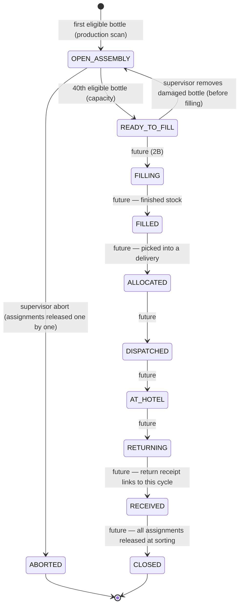

# 005 — Crate Lifecycle

This document describes reusable transport crates, crate membership and why the crate is the primary physical logistics unit.

Status: Updated 2026-10-11 — crate capacity, circulation cycle and membership confirmed by the
owner ([ADR 0021](adr/0021-crate-capacity-and-circulation-cycle.md), superseding ADR 0004);
detailed design in [doc 020](020-production-core-v0.1.md). Production Core v0.1 implements the
first two cycle states; the rest of the circulation is designed but not built.

## Confirmed requirements

- Crates are reusable and have permanent identities: a human-readable code (`AYV-C-000001`) and a
  separate opaque QR token under the ADR 0014 host policy; AYVO prints controlled crate labels
  _(owner, 2026-10-11)_.
- **Capacity is 40 bottles** — data on the crate type and a snapshot on each cycle, never a
  constant. It is the **same** reusable crate for assembly, filling, shipment to the hotel and
  the return to AYVO; there is no separate 20-bottle outbound crate _(owner, 2026-10-11)_.
- Two crate types now: hand soap and shower gel _(owner, 2026-10-11)_.
- One **crate cycle** is one complete circulation. Empty, freshly labelled bottles are scanned
  into the crate **before** filling; the 40th eligible bottle makes the cycle `READY_TO_FILL`; a
  41st is impossible; a partial cycle is never made ready manually _(owner, 2026-10-11)_.
- A later production order may continue a partially assembled crate only when product, product
  category, recipe version, label-template version and crate type all match the cycle's snapshot
  _(owner, 2026-10-11)_.
- A completed and verified crate is handled as one logistics unit: one crate scan stands for its
  known bottle identities; bottles are **not** rescanned at every later warehouse operation.
- Crate membership is **temporary and historical**; a bottle never belongs to two active crates.
- Return crates may be partial, mixed or contain not-yet-identified bottles _(owner, 2026-10-10)_;
  a future return receipt links to the **same** circulation cycle.
- The public page of a crate QR shows only that it is an AYVO reusable crate and a safe contact or
  return instruction — never hotel, order, contents, count, tracking, location or history
  _(owner, 2026-10-11)_.

### Superseded (kept for history)

- ~~Standard outbound crate capacity 20; a READY outbound crate contains exactly 20 bottles of the
  same product and size; bottles are filled, then scanned into the crate (n/20)~~ — owner
  2026-10-10, superseded 2026-10-11 by ADR 0021.

## Crate cycle — one circulation

`OPEN_ASSEMBLY`, `READY_TO_FILL` and `ABORTED` are implemented in Production Core v0.1; later states
are the confirmed direction, designed in doc 020 §4.2.

### Membership model (doc 020 §3.4)

- `crate_assignments(cycle, bottle, ordinal 1…capacity, slot_code NULL, snapshot, source,
production_order, session, assigned_event, operation, released_*)` — ordinals are assignment
  ordinals, not a physical grid (`slot_code` is reserved for one).
- Partial unique index on `bottle_id WHERE released_at IS NULL`; partial unique
  `(cycle_id, ordinal) WHERE released_at IS NULL`; ordinal ≤ the cycle's capacity; inserts only
  into `OPEN_ASSEMBLY`; all checked by the database under the canonical lock order.
- Assignments are never deleted; leaving a crate closes them with a reason, an event and an
  operation id.

### When is membership released?

| Moment                                              | Status                                                 |
| --------------------------------------------------- | ------------------------------------------------------ |
| Damaged bottle removed during assembly (supervisor) | v0.1 — bottle goes on hold (quarantine), ordinal freed |
| Cycle aborted (supervisor)                          | v0.1 — every assignment released individually          |
| Delivered to the hotel vs. identified at sorting    | open (future returns design)                           |

### Returned crates

At goods-in the crate is scanned as a container with a recorded physical quantity, and the return receipt links to the crate's **current circulation cycle** (no separate return cycle, ADR 0021). Its bottle contents are treated as **unknown**: return crates may be partial or mixed (confirmed), so no capacity or product rule applies to what physically comes back. Bottle identities become known again only at sorting ([009](009-returns.md)), where each assignment is released individually; the cycle closes when none is active.

### Crate events

Append-only `crate_events` written in the same transaction as every cycle change, correlated by
one operation id with bottle events, stock movements and assignments. v0.1 types: `REGISTERED`,
`LABEL_PRINTED`, `CYCLE_OPENED`, `CLAIMED`, `CLAIM_RELEASED`, `CLAIM_TAKEN_OVER`,
`BOTTLE_REMOVED`, `READY_TO_FILL`, `RETURNED_TO_ASSEMBLY`, `CYCLE_ABORTED`; later phases add
their own. See [ADR 0006](adr/0006-auditable-lifecycle-history.md).

## Open questions

- ~~Are there crate sizes/types other than the 20-bottle standard outbound crate?~~ — resolved
  2026-10-11: one crate of capacity 40, two types (ADR 0021).
- ~~May one READY crate mix fill batches?~~ — superseded: a cycle never mixes product, recipe or
  label versions; fill batches are a 2B topic.
- Can anything other than a full, filled crate ever be dispatched (exception handling)? Who may
  authorize it?
- What does quality approval of a filled crate mean exactly (who approves, what is checked)?
- Crate damage/retirement criteria; crate washing?
- Are crates owned by AYVO only, and are hotels accountable for unreturned crates?
- When exactly is crate membership released (at delivery or at sorting)?
