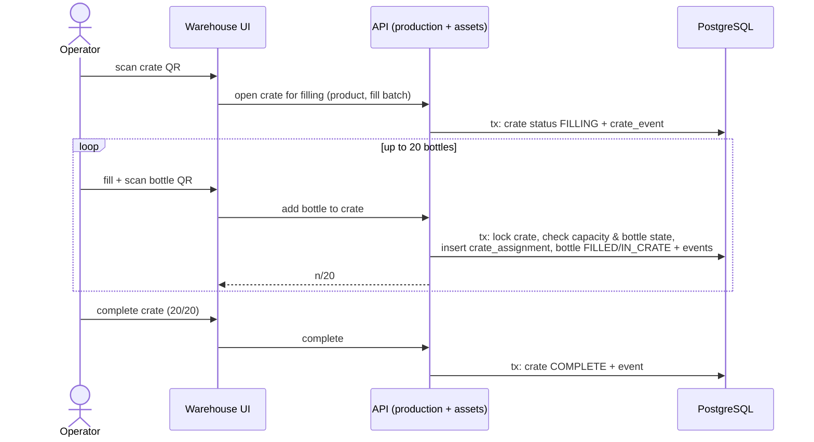
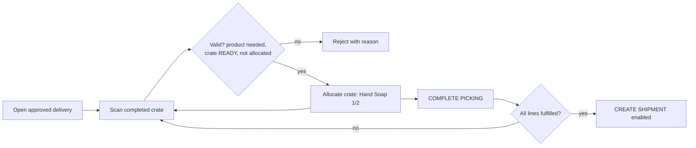

# 006 — Warehouse Workflows

This document describes the scanning-driven warehouse workflows: filling, crate completion, picking, dispatch, goods-in and sorting.

Status: Draft — foundation phase (2026-10-10)

## Confirmed requirements

- Filling: operator opens/scans a crate → selects product/fill batch → fills bottle → scans bottle directly into crate → UI shows n/20 → at 20/20 crate can become complete.
- Completed, verified crates are handled as one unit; no rescanning of bottles in later operations.
- A **READY** outbound crate contains exactly 20 bottles of the same product and size _(confirmed by owner 2026-10-10)_.
- Return crates may be partial, mixed, or initially contain unknown bottle identities _(confirmed by owner 2026-10-10)_.
- Picking: operator opens a proposed/approved delivery and scans suitable completed crates into it; UI shows per-product progress (e.g. "Hand Soap 2 / 2 crates").
- COMPLETE PICKING validates contents, then CREATE SHIPMENT becomes possible.
- Goods-in: scan returned crate, record physical quantity, associate with hotel where known.
- Sorting: individual bottle QR scanned; bottle routed to washing, inspection, quarantine or retirement.

## Proposed design (requires confirmation)

### Filling

Per-scan validation (proposal): bottle exists, is not retired, not quarantined, not in another active crate, is in a fillable state; crate is in FILLING, not full; product and size match the crate's product and size (confirmed READY rule).

### Picking a service delivery

- Allocating a crate is one transaction: crate allocation + crate event + bottle events for all known bottles in the crate.
- No bottle rescans are required.

### Goods-in and sorting

See [009 — Returns](009-returns.md).

### UX principles (proposal)

- Scanner-first UI (keyboard-wedge barcode scanners), large touch targets, immediate audible/visual feedback.
- Every rejection states a reason; nothing silently ignored.
- Every scan action is idempotent where possible (rescanning the same bottle into the same crate is a no-op with feedback, not a duplicate).

## Open questions

- Scanner hardware (handheld wedge scanners, mobile camera, dedicated devices)? Offline operation needed?
- Is quality approval a separate step/role from filling?
- Picking rules: FIFO by fill date? Fill batch expiry constraints?
- What happens to a delivery that cannot be fully picked (short shipment allowed? who approves?)
- Stock locations within the warehouse — needed, and at what granularity?
