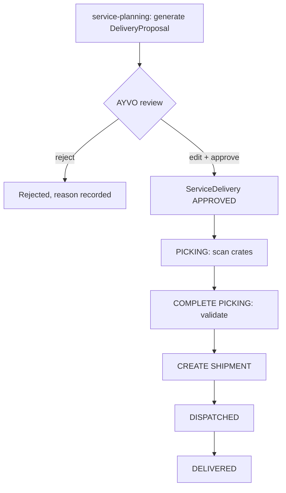

# 008 — Service Deliveries

This document describes recurring service deliveries to hotels, automatic service planning (proposals), picking by crate and shipment creation.

Status: Draft — foundation phase (2026-10-10)

## Confirmed requirements

- This is **not** traditional ecommerce; hotels normally receive **recurring** AYVO service deliveries.
- Quantities are expressed per product; crates contain 20 bottles. Example: 40 Hand Soap = 2 crates; 60 Hair & Body Wash = 3 crates.
- A **READY** outbound crate contains exactly 20 bottles of the same product and size _(confirmed by owner 2026-10-10)_.
- Warehouse operator opens the proposed delivery and scans suitable completed crates into it; UI shows progress per product (e.g. "Hand Soap 2 / 2 crates", "Hair & Body Wash 3 / 3 crates").
- **COMPLETE PICKING** validates contents; then **CREATE SHIPMENT** is allowed.
- Carrier integration (e.g. PPL) will eventually return shipment ID, tracking number, label PDF/ZPL and shipment status. **Not required in the first implementation.**
- Automatic service planning must create recurring delivery **proposals requiring AYVO approval**, not shipments.
- Quantity is **not** permanently fixed. Future calculations may use: hotel product configuration, target inventory, minimum inventory, prior deliveries, confirmed returns, consumption history, manual hotel inventory data, estimated consumption.

## Proposed design (requires confirmation)

### Flow

### Proposed delivery states

`DRAFT` → `APPROVED` → `PICKING` → `PICKED` → `SHIPMENT_CREATED` → `DISPATCHED` → `DELIVERED`, plus `CANCELLED`. Proposal only.

### Delivery lines

| Field             | Notes                                                                                        |
| ----------------- | -------------------------------------------------------------------------------------------- |
| product           |                                                                                              |
| requested_bottles | e.g. 40                                                                                      |
| required_crates   | derived: requested_bottles / 20 (only exact multiples until partial-crate rules are defined) |
| picked_crates     | count of allocated crates for that product                                                   |

### Validation at COMPLETE PICKING (proposal)

- Every line has picked_crates == required_crates.
- Every crate was READY (confirmed rule: exactly 20 known bottles of the same product and size) and is ALLOCATED to this delivery only, holds the right product, none of its bottles retired/quarantined.
- Executed in one transaction; on success crate and bottle events are appended for all contained bottles.

### Planning (proposal for first version)

The first version should be deliberately simple and transparent: proposal quantities from ServiceConfiguration (e.g. target stock) and schedule (service frequency), always editable by AYVO before approval, with the calculation inputs stored on the proposal for explainability. More advanced inputs (consumption history, returns, hotel inventory) are added later once their rules are defined.

### Carrier adapter (later)

A `CarrierAdapter` interface in the deliveries module (createShipment, getLabel, getStatus) with a manual implementation first and a PPL implementation later. Carrier calls happen outside DB transactions; results are persisted with idempotency keys.

## Open questions

- Exact planning formula and which inputs apply in v1.
- Approval: who approves, can proposals be auto-approved ever?
- Quantities not divisible by 20 — round up/down? (A partial outbound crate cannot be READY.)
- Does a delivery line need to specify bottle size as well as product?
- One delivery per hotel location, or can one delivery serve several locations?
- Carrier choice, services, label format (PDF vs ZPL), pickup scheduling, and status sync method.
- Is proof of delivery required? Who marks a delivery as DELIVERED without carrier integration?
- Delivery of empty return crates to hotels — part of the same shipment?
