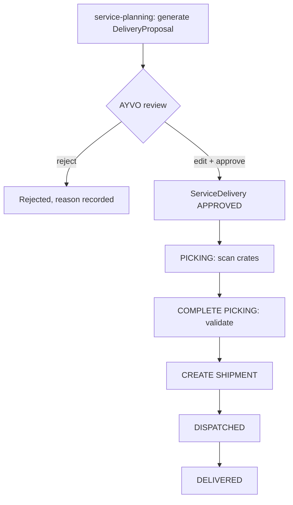

# 008 — Service Deliveries

This document describes recurring service deliveries to hotels, automatic service planning (proposals), picking by crate and shipment creation.

Status: Draft — foundation phase (2026-10-10)

## Confirmed requirements

- This is **not** traditional ecommerce; hotels normally receive **recurring** AYVO service deliveries.
- Quantities are expressed per product; a crate holds **40** bottles of one product, recipe and label version _(owner, 2026-10-11, [ADR 0021](adr/0021-crate-capacity-and-circulation-cycle.md))_. Example: 80 Hand Soap = 2 crates; 120 Shower Gel = 3 crates.
- ~~Crates contain 20 bottles; a READY outbound crate contains exactly 20 bottles of the same product and size~~ _(owner 2026-10-10, superseded 2026-10-11 by ADR 0021)_.
- **Whole crates** _(owner, 2026-10-11)_: in v0.1 customer order lines are expressed as **whole crates**; a standard crate contains exactly **40** compatible bottles; a partial standard crate is never dispatched to a hotel; an order may contain any whole number of crates per product. The dispatched bottle quantity per standard product/crate type is therefore a multiple of 40. A smaller quantity later needs a separately defined crate type/capacity and a corresponding commercial product — never an exception that partially fills a standard crate.
- Warehouse operator opens the proposed delivery and scans suitable completed (filled) crates into it; UI shows progress per product (e.g. "Hand Soap 2 / 2 crates", "Shower Gel 3 / 3 crates"). Picking continues the crate's circulation cycle (`FILLED → ALLOCATED`, ADR 0021).
- **COMPLETE PICKING** validates contents; then **CREATE SHIPMENT** is allowed.
- Carrier integration (e.g. PPL) will eventually return shipment ID, tracking number, label PDF/ZPL and shipment status. **Not required in the first implementation.**
- Automatic service planning must create recurring delivery **proposals requiring AYVO approval**, not shipments.
- Quantity is **not** permanently fixed. Future calculations may use: hotel product configuration, target inventory, minimum inventory, prior deliveries, confirmed returns, consumption history, manual hotel inventory data, estimated consumption.

## Proposed design (requires confirmation)

### Flow

### Proposed delivery states

`DRAFT` → `APPROVED` → `PICKING` → `PICKED` → `SHIPMENT_CREATED` → `DISPATCHED` → `DELIVERED`, plus `CANCELLED`. Proposal only.

### Delivery lines

| Field             | Notes                                                                                      |
| ----------------- | ------------------------------------------------------------------------------------------ |
| product           |                                                                                            |
| requested_bottles | e.g. 40                                                                                    |
| required_crates   | whole crates per product (v0.1 order lines are expressed in crates; bottles = crates × 40) |
| picked_crates     | count of allocated crates for that product                                                 |

### Validation at COMPLETE PICKING (proposal)

- Every line has picked_crates == required_crates.
- Every crate was filled and complete (40 known bottles of one product, recipe and label version — ADR 0021) and is ALLOCATED to this delivery only, holds the right product, none of its bottles retired/quarantined.
- Executed in one transaction; on success crate and bottle events are appended for all contained bottles.

### Planning (proposal for first version)

The first version should be deliberately simple and transparent: proposal quantities from ServiceConfiguration (e.g. target stock) and schedule (service frequency), always editable by AYVO before approval, with the calculation inputs stored on the proposal for explainability. More advanced inputs (consumption history, returns, hotel inventory) are added later once their rules are defined.

### Carriers per site (decided 2026-10-12, ADR 0023, doc 022 §8)

Carriers are configured per site (accounts, sender/return addresses, pickup settings, services,
priority, active state; credentials only as references to protected secrets). A dispatch keeps a
snapshot of its origin site, carrier and service. Hotels may choose among the services their
fulfilment site permits and never see its credentials.

### Carrier adapter (later)

A `CarrierAdapter` interface in the deliveries module (createShipment, getLabel, getStatus) with a manual implementation first and a PPL implementation later. Carrier calls happen outside DB transactions; results are persisted with idempotency keys.

## Open questions

- Exact planning formula and which inputs apply in v1.
- Approval: who approves, can proposals be auto-approved ever?
- ~~Quantities not divisible by the crate capacity (40)?~~ — **resolved 2026-10-11** (see "Whole crates" above).
- Does a delivery line need to specify bottle size as well as product?
- One delivery per hotel location, or can one delivery serve several locations?
- Carrier choice, services, label format (PDF vs ZPL), pickup scheduling, and status sync method.
- Is proof of delivery required? Who marks a delivery as DELIVERED without carrier integration?
- Delivery of empty return crates to hotels — part of the same shipment?
