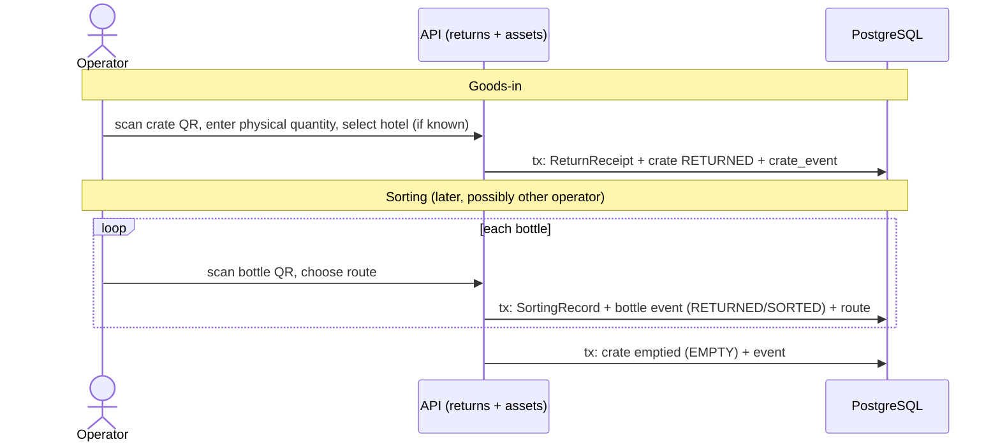

# 009 — Returns

This document describes how returned crates and bottles are received and processed back into circulation (or retired).

Status: Draft — foundation phase (2026-10-10)

## Confirmed requirements

- Hotels return one or more crates.
- At goods-in: scan returned crate, record physical quantity, associate return with hotel where known.
- Do **not** assume individual bottle identities are known at goods-in.
- Return crates may be **partial, mixed, or initially contain unknown bottle identities** _(confirmed by owner 2026-10-10)_.
- During sorting/processing: individual bottle QR is scanned, identity becomes known, bottle routed to washing, inspection, quarantine or retirement.
- Returned bottles generally do not return in the crate they were delivered in, and may end up in completely different crates in the next fill cycle.
- RETIRED is operationally terminal (reversible only by an authorized, audited correction); DISPOSED/DESTROYED is irreversible _(confirmed by owner 2026-10-10)_.
- A **completed reuse cycle** is counted when a bottle delivered to a hotel is returned and **individually identified** at sorting _(confirmed by owner 2026-10-10)_ ([004](004-bottle-lifecycle.md#reuse-cycle-count)).

## Proposed design (requires confirmation)

### ReturnReceipt (goods-in)

| Field                    | Notes                                             |
| ------------------------ | ------------------------------------------------- |
| hotel_id                 | nullable — "where known"                          |
| crate_id(s)              | one receipt may include several crates (proposal) |
| physical_quantity        | counted, per crate                                |
| received_at, received_by |                                                   |
| notes                    | damage, discrepancies                             |

### Sorting

- Each bottle scan creates a SortingRecord linked to the ReturnReceipt (where determinable) and appends bottle events.
- Routing options: WASHING, INSPECTION, QUARANTINE, RETIREMENT. Criteria are an open question. QUARANTINE means opening an active `bottle_holds` row (eligibility overlay, not a lifecycle state — doc 020 §3.5); the bottle stays ineligible for production, crate assignment and dispatch until the hold is resolved.
- If the bottle's last known hotel differs from the receipt's hotel, the discrepancy is recorded, not silently corrected.
- Reconciliation (proposal): compare physical quantity vs. identified bottles per receipt and report differences.

### Reconstructing return history

Return history per hotel = ReturnReceipts by hotel + sorted bottles whose last delivery was to that hotel. Both are kept because they can differ.

## Open questions

- Return crates may be mixed (confirmed) — does that include bottles from several hotels (e.g. shared collection runs)?
- Is the physical quantity a count of bottles, or also fill level / empty vs. partially used?
- What happens to residual product in returned bottles?
- Routing criteria for washing vs. inspection vs. quarantine vs. retirement.
- Are unidentifiable bottles (unreadable QR) possible, and how are they handled?
- How are returns collected (carrier pickup, AYVO driver, with next delivery)?
- Lost/unreturned bottles: any consequence for the hotel?
