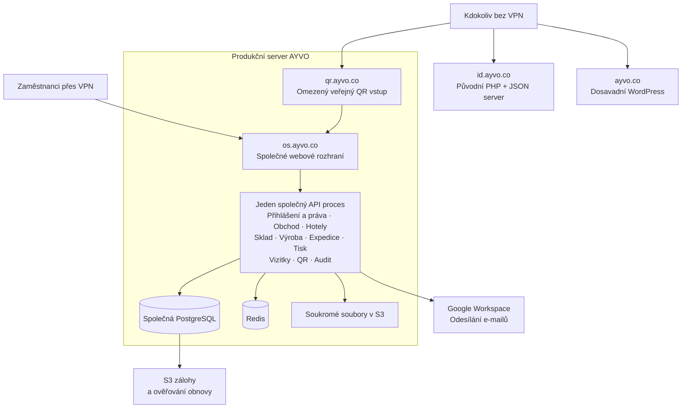
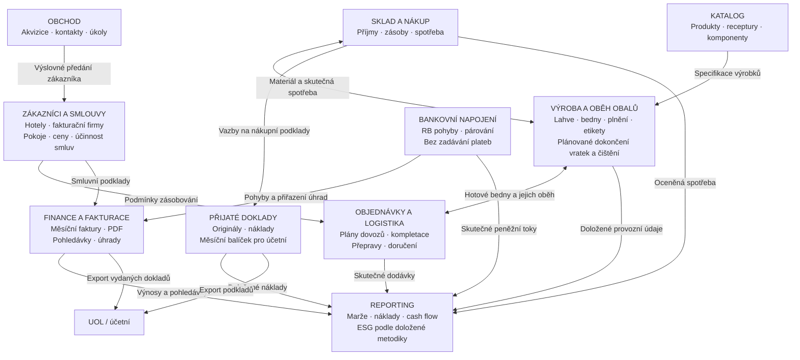
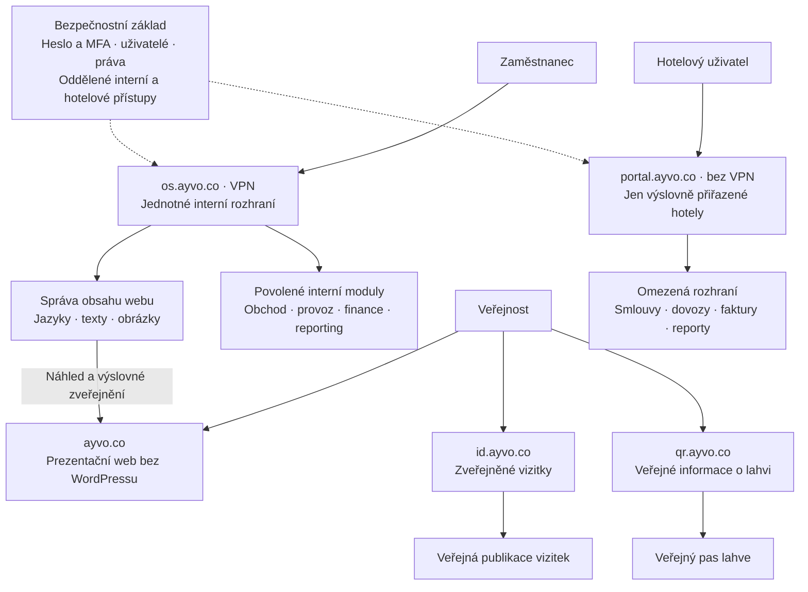

# AYVO — mapa dnešního stavu a cílových modulů

Datum: 24. 10. 2026. Stav: **podklad k diskusi, nikoli schválený implementační plán**.
Výchozí nasazený release DEV/PROD: `db8206d527892d9cf25c8881b04d44081b8b2a4a`.

Majitel požaduje samostatně použitelné, nasaditelné a přesunutelné moduly,
jejich oprávnění a jasná rozhraní bez kaskádového pádu. Požadavek je potvrzený;
konkrétní runtime/datové hranice, přechodový ADR a implementace čekají na review
a samostatné schválení. Tento dokument původní ADR 0001 sám nenahrazuje.

Diagramy jsou přehledová mapa v Mermaid, ne formálně validovaný model ArchiMate.
Šipky cílových diagramů vyjadřují obchodní informace a přístupové vazby,
nikoli již rozhodnutou synchronní RPC komunikaci nebo fyzickou síťovou topologii.

## 1. Dnešní stav — skutečně existující prvky

- OS je podle [ADR 0001](../adr/0001-modular-monolith.md) modulární monolit:
  jeden Nest API proces a jeden Next web, společná databáze. Oddělené doménové
  složky ještě nejsou nezávislé běhové jednotky.
- Jednotlivé domény mají vlastní pravidla a oprávnění, ale porucha společného
  procesu/DB může zasáhnout více modulů. Neprohlašovat je za crash-isolated.
- Heslo a TOTP jsou nativní, nikoli WorkOS; zálohy a izolovaná obnova jsou ověřené.
- Nové vizitky již existují v PROD na `/id/<slug>` přes VPN. Veřejná doména
  `id.ayvo.co` dosud zůstává na původním serveru; nový veřejný ID vstup není součástí
  tohoto release. Samotná změna DNS by jej nezprovoznila.
- Web WordPress podle majitele slouží pouze jako HTML/CSS prezentace bez formulářů.
  Hotelový portál, plná smluvní fakturace, RB napojení a ESG/manažerské finance
  níže jsou budoucí práce, nikoli již nasazené funkce.
- QR šipka do webu neznamená veřejnou administraci: veřejná edge dovoluje jen
  omezené anonymní cesty; OS a interní API zůstávají za VPN.

## 2. Cílové obchodní moduly a jejich vazby — návrh

Rámečky jsou kandidáti na samostatné provozní jednotky, ne povolení ihned
vytvořit službu pro každou tabulku. Zvláště hranice skladu, výroby a expedice
musí zachovat současné transakční a databázové invarianty.

### Důležitá pravidla

- Základní fakturace vychází ze smlouvy: pokoje × sjednaná měsíční cena, nikoli
  počet dodaných lahví. Viz [ADR 0007](../adr/0007-separate-billing-from-logistics.md).
- Finance mají být použitelné i bez skladu; přímé finanční podklady mohou vznikat
  samostatně. Chybějící skladová integrace však nesmí vytvářet falešně přesnou marži.
- Bankovní výpadek neblokuje evidenci faktur. Synchronizace a párování mají vlastní
  stav, idempotenci a omezené retry. Rozsah je čtení pohybů, nikoli iniciace plateb.
- Přijatá faktura, příjem zásoby a zaplacení nejsou tři různé náklady.
- Účetní export pro UOL není automaticky plnohodnotná účetní kniha, mzdový systém
  ani potvrzení zaúčtování. Samostatný úplný účetní modul by byl další rozhodnutí.
- Vydané faktury/PDF se generují v AYVO; nenapojovat pro ně automaticky iDoklad.
- ESG jen s doloženými zdroji/metodikou; provozní událost není sama o sobě CO2e úspora.
- Tiskoví agenti a dopravci jsou integrační hranice provozu. Výpadek tiskárny nebo
  dopravce nesmí znamenat falešně potvrzený tisk/předání ani neomezené opakování.

## 3. Vstupy, oprávnění a budoucí web — návrh

- Jednotná administrace neznamená jeden nerozpojitelný backend. Povolení modulu,
  role uživatele a scope hotelu/provozovny jsou různá pravidla a vyhodnocují se
  serverově i při přímém volání API/downloadu.
- Hotelové účty/pozvánky spravuje interní administrace, ale hotel nedostane
  interní role ani cizí hotely. Veřejný portál nesmí zpřístupnit interní admin API.
- Diagram identity neřeší finální token/session kontrakt ani nevyžaduje synchronní
  volání centrální služby na každý požadavek. Revokace práv a chování při výpadku
  identity musí projít bezpečnostním návrhem, nesmí vzniknout MFA nebo role bypass.
- Webové texty a jazyky: koncept → náhled → publikace → možnost návratu.
  Cíl je jednoduchá správa konkrétního webu, nikoli obecný page builder.
- Veřejný publikovaný web by neměl potřebovat živou administraci pro každé čtení.
  U skrytých vizitek, smluv a faktur naopak nesmí cache obcházet odvolání přístupu.
- Společné souborové technologie jsou možné, ale soukromé smlouvy/doklady,
  veřejné fotografie a krátkodobé DB dumpy nemají společnou retenci ani oprávnění.

## 4. Co musí návrh skutečně prokázat

1. Zastavení jednoho procesu neukončí ostatní; limity RAM/CPU/DB spojení brání
   nekontrolované kaskádě. Samostatný modul lze sestavit, nasadit i přesunout.
2. Výpadek banky nechá běžet faktury; výpadek reportingu nezastaví provoz;
   výpadek marketing webu nezastaví sklad. Závislá funkce pravdivě oznámí omezení.
3. Oprávnění nejsou pouze skryté menu. Každý modul má definovaný kontrakt, scope,
   datového vlastníka a pravidla případného odvolání přístupu.
4. Žádné přímé čtení cizích tabulek mezi službami, duplicitní obchodní pravda nebo
   nutnost vydávat všechny moduly společně kvůli nestabilní sdílené implementaci.
5. Existující ACID skladové a životní invarianty nelze potichu nahradit několika
   síťovými voláními. Před rozdělením určit obnovu, idempotenci a konzistenci.
6. Sdílený host, gateway, identity, DB cluster a úložiště zůstávají možnými společnými
   failure domains. Kontejnery na jednom VPS nejsou vysoká dostupnost celého serveru.
7. Stejné schválené verze/artefakty, topologie a kontrakty musí projít DEV před PROD.
   Kód ani reálná data se nesmějí mezi prostředími nahrazovat ad-hoc kopiemi.

## 5. Otevřené body pro pozdější projití

- Přesná velikost runtime jednotek, zejména sklad/výroba/expedice, identity a dokumenty.
- Datové vlastnictví, případné oddělení DB účtů/databází a skutečné sdílené závislosti.
- Synchronní API versus odolné události u jednotlivých operací; bez automatického
  přidávání brokeru, Kubernetes nebo externího dodavatele.
- Verze kontraktů, postup samostatného vydávání a testy nekompatibilních kombinací.
- Přechod po malých krocích bez big-bang refaktoru a bez rozbití běžícího provozu.
- Ve financích navíc pravidla období, dopředu/zpětně, hotel/skupina, DPH, číselné
  řady, oceňování spotřeby a požadavky UOL; nic z toho diagram sám nerozhoduje.
- Veřejný ID cutover potřebuje předem ověřený HTTPS a zachování starého webu pro
  návrat během propagace DNS. Tento dokument nepovoluje DNS ani přenos TLS klíčů.

## 6. Rozsah tohoto zápisu

Jde pouze o uložení diskuse a tří diagramů na výslovnou žádost majitele.
Žádný kód, migrace, role, nasazení, infrastruktura nebo DNS se tím nemění.
Diagramy nejsou důkazem hotové izolace ani povolením zahájit velký refaktor.

Výchozí podklady: ADR 0001, ADR 0007, docs 021/028/029/031/032/034/038,
docs/employee-business-cards.md a aktuální požadavky majitele z 24. 10. 2026.
