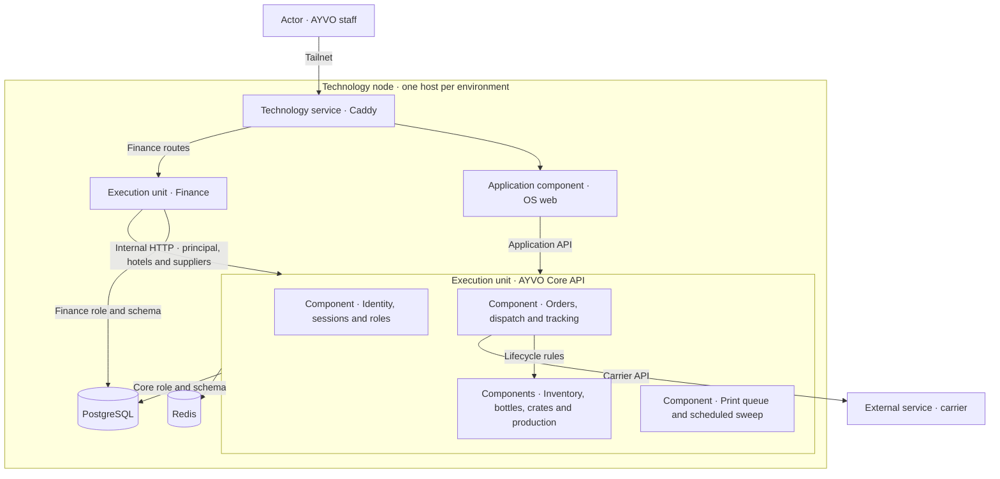
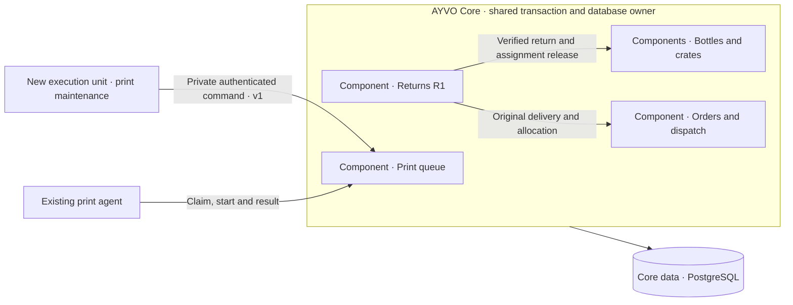

# Proposed ADR — Runtime isolation, first step

Status: **Proposed, for owner decision after independent review.**  
Baseline: `main` at `bcdd9260ede841e82ea9b758e62fd10c16d139ac`. R1 return intake is
reviewed separately in [PR #129](https://github.com/ElDiemo/AyvoOS/pull/129).
This is the concrete first step of the earlier
[ADR 0038 proposal](https://github.com/ElDiemo/AyvoOS/pull/65).
[ADR 0001](../adr/0001-modular-monolith.md) governs the core until a transition is accepted.

## Current architecture

This is a simplified ArchiMate-style application and technology view. Boxes inside the API
are logical application components. The database cylinder is one PostgreSQL instance.

- Finance has its own entry point, Compose service and limits. Its internal client calls the core
  to validate sessions and access core data. A Finance process failure can be isolated from
  operations. A core identity failure makes dependent authenticated Finance operations unavailable.
  See [Finance module](../../apps/api/src/finance/finance.module.ts),
  [core client](../../apps/api/src/finance/core-client.ts) and [PROD Compose](../../deploy/prod/compose.yml).
- The core API hosts scheduled work in the same process as interactive requests. The printing
  sweeper and the carrier poller start timers in their Nest providers.
  See [printing sweeper](../../apps/api/src/printing/print-sweeper.service.ts) and
  [carrier poller](../../apps/api/src/orders/shipment-poller.service.ts).
- The host, PostgreSQL, Caddy and core identity remain shared failure domains where used.
  PostgreSQL roles separate access. They still share the server, I/O and connection capacity.

## Proposed boundary

**Operations core** owns the receipt, bottle, crate, order and stock data. A verified return writes
the identification, bottle status and release of the original assignment together. Filling and
stock movements also remain within their existing transaction. Orders retain their immutable shipped
contents and delivery evidence. R1 remains a logical component in the same process and consumes
internal services for assets, crates and orders. An error in an R1 operation must roll back the
whole operation or return the deliberately committed issue outcome. A process-wide crash still
affects the whole core.

**First independent process** moves the timer for recovery of expired print job leases into a
small worker. It owns execution of that schedule and holds no business tables. Printing in the
core remains authoritative for print jobs, events, claim tokens and transitions. The print agent
already runs a sweep before claiming a job. Preserve that recovery path and the distinction
between an unstarted claim and a job already sent to the printer.
See [the existing queue service](../../apps/api/src/printing/print-queue.service.ts).

### Contract and limits for the pilot

- One private `POST /api/internal/maintenance/v1/printing/sweep` command. The core performs one
  bounded batch and returns only counts of requeued and uncertain jobs. Service authentication is
  limited to this command. The worker has no database credentials or user-session credentials.
  Both DEV and PROD edges drop the internal path. No public worker port.
- Core transitions remain conditional and transactional with their audit event. Coordinate the
  scheduled command and the agent claim sweep so an expired job changes state and records its
  event only once. An expired started job becomes uncertain and is never automatically sent again.
- Bound batch size, lock wait, statement duration and concurrent maintenance work in the core
  itself. An HTTP timeout alone cannot stop SQL. The worker runs a single request at a time,
  uses a finite deadline and backs off after an error. Lost responses and restarts may repeat the
  command safely. Select the exact budgets from measured DEV baseline and publish them in the
  implementation PR.
- Give the worker its own process, resource limits, health and deploy/rollback path. Report
  last successful sweep, error and age of outstanding work without exposing job or customer
  details. Its process health does not control readiness of the core.
- Stage the compatible core contract first, then switch scheduler ownership once. Start the
  worker only when the contract is available. If the worker is stopped, on-demand recovery
  remains available. Reverting to the in-process schedule stops the worker first and restores
  the existing scheduler setting. Both environments use the same release path and topology.

## Acceptance on DEV

Test in the reviewed DEV topology with synthetic jobs and no live print. Record baseline, exact
release, observed failures, recovery and what stayed available.

| Fault injected | What must be demonstrated |
| --- | --- |
| Stop, restart or exceed the worker resource limit | Core readiness, sign-in and unrelated inventory, production and dispatch requests still work within their agreed budgets. Automatic sweep pauses. Claim-time recovery works. Restart resumes the schedule without duplicate events or a duplicate print. |
| Reject or delay the private command, or saturate the sweep budget | Requests and retries remain bounded. No growth in in-flight maintenance work. Core reads and writes stay within their budgets, including when a job row is locked. The worker reports the failed sweep and recovers. |
| Commit the sweep and lose its response | A retry leaves the same recorded job transitions. An unstarted claim can be requeued and a started job remains uncertain. |
| Call the private command through edge, without credentials, or with a different unit's token | No command executes. Only the worker credential on the private path is accepted. |
| Stop the core | The worker reports the dependency unavailable and resumes after recovery. Finance rejects dependent authenticated calls. Shared host, PostgreSQL and gateway outages are documented separately from the worker-isolation claim. |

For the R1 release, add an acceptance check independently of this pilot: refuse a return scan or
force a transactional failure in test, confirm no partial receipt, bottle or assignment changes,
and verify an unrelated existing production and dispatch walk. Keep the release's data-safe
rollback decision after the first real return write.

## Sequence and decision

1. Accept this scope. Deliver the print maintenance pilot in its own PR and prove independent
   lifecycle on DEV before promoting the same reviewed release to PROD.
2. Use the measured pilot results to design the next worker boundary. Carrier tracking is the
   candidate with external network I/O. Its own proposal must move the carrier I/O off the
   request process while the core retains delivery writes. Specify credential ownership,
   fenced leases, timeout/retry budget and the manual refresh path before implementation.
3. Review candidates with genuinely independent data, such as Sales, individually. Keep the
   hotel portal on its own proposed boundary in [PR #127](https://github.com/ElDiemo/AyvoOS/pull/127).
   Host and database resilience require separate decisions and recovery evidence.

Owner decision requested: approve the operations transaction boundary and the print maintenance
pilot as the first independent process. The evidence from that pilot determines the next step.
